 

   

 

 

## About

I build and operate web systems, APIs and desktop applications, with a focus on **Node.js and TypeScript**, **databases** and **AI automation**: agents, MCP and LLM integrations.

My work covers internal process automation, marketplaces and digital products running in production, including platforms with **35,000+ users** and **1,000+ active stores**. Based in Toledo, Paraná, Brazil.

| Right now | |
| :--- | :--- |
| **Full Stack Developer** | Hagap, building web and desktop systems that automate internal processes |
| **Founder and Developer** | MyGames, a marketplace running in production |
| **Student** | Software Engineering at Biopark, graduating in 2027 |

 

## What I do

| | Focus |
| :--- | :--- |
| **AI and Automation** | AI agents, MCP servers, LLM integrations with Gemini and OpenAI, prompt engineering, browser automation with Puppeteer and Selenium |
| **Backend and APIs** | Node.js, Express, REST and GraphQL APIs, plus Django and Spring |
| **Full stack** | React, Next.js, Angular, Vue.js and Tailwind CSS |
| **Desktop apps** | Electron applications for automation and operations |
| **Data** | PostgreSQL, MySQL, MariaDB, MongoDB, Redis for cache, sessions and queues, and SQLite |
| **Infrastructure** | Docker, Linux, Nginx, microservices, AWS, Google Cloud, CI/CD, RabbitMQ and Kafka |

 

## Tech stack

<b>LANGUAGES</b> 

<b>FRONTEND</b> 

<b>BACKEND</b> 

<b>AI AND AUTOMATION</b>       

<b>DATA</b>  

<b>INFRASTRUCTURE</b> 

<b>TOOLS</b>  

 

## Featured projects

| Project | What it is | |
| :--- | :--- | :--- |
| **MyGames** | Marketplace for game items, accounts and currencies, with payments, digital delivery and platform security | [mygames.com.br](https://mygames.com.br) |
| **Galaxy CDN** | CDN for assets, images and media with distributed caching | [galaxycdn.com.br](https://galaxycdn.com.br) |
| **Free Gemini API** | API with sessions to integrate Gemini models into apps and automations | [freegemini.felipeestrela.com.br](https://freegemini.felipeestrela.com.br) |
| **AllDrive** | Unified workspace for Google Drive and S3, with fast sharing and storage management | [alldrive.cloud](https://alldrive.cloud) |
| **AstroHub** | Platform and desktop app for secure automations, campaigns and Discord management | [astrohub.neonstore.cloud](https://astrohub.neonstore.cloud) |
| **Frameclear** | Web studio for removing logos and fixed areas from videos directly in the browser | [frameclear.felipeestrela.com.br](https://frameclear.felipeestrela.com.br) |

 

## Experience

| Period | Role | Highlights |
| :--- | :--- | :--- |
| **2023 to Present** | **Full Stack Developer** Hagap | Web and desktop systems for internal process automation Team management modules, invoice issuing and document organization Custom forms and tailored operational workflows |
| **2022 to Present** | **Founder and Developer** MyGames | Architecture and development of a marketplace for game items, accounts and currencies Backend, frontend, payment integrations, digital delivery and platform security Ongoing operation and evolution in production |
| **2023** | **E-commerce Specialist** Ativa EPIS | Online inventory control with monitoring to prevent stockouts Storefront maintenance: banners, layout adjustments and visual content |
| **2021 to 2022** | **Founder and Developer** Lunar Bot | Discord bot for selling digital products 35,000+ users and 1,000+ active stores at the same time Availability, performance and customer base growth |

 

## Education and languages

| | |
| :--- | :--- |
| **Software Engineering** | Biopark Educação, 2024 to 2027 (6th term) |
| **Projeto Zero ao Um** | Biopark, top student of Class 2, 2021 to 2022 |
| **High School** | Colégio Estadual Jardim Gisele, 2020 to 2023 |
| **Certifications** | 54 completed course certificates |

English: technical reading and professional communication.

 
