

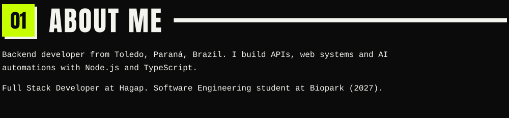

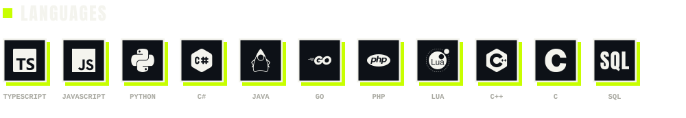
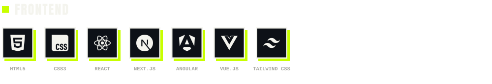
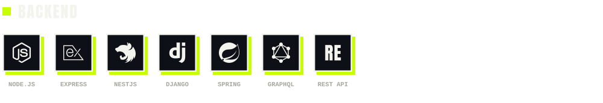
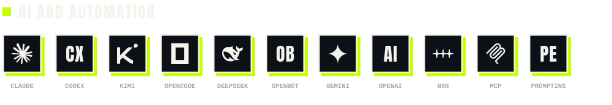
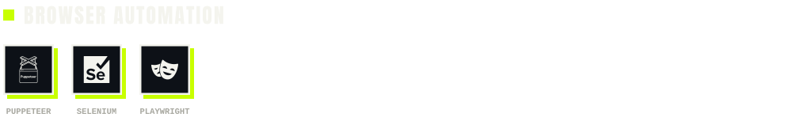
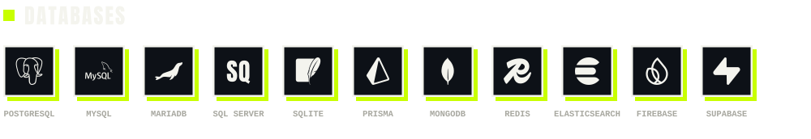
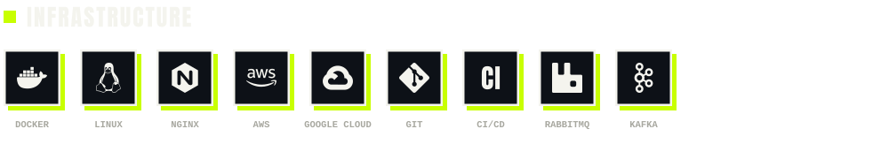
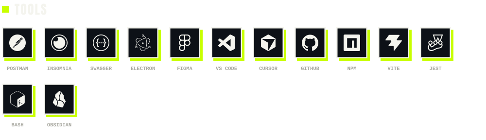

<a href="https://galaxycdn.com.br">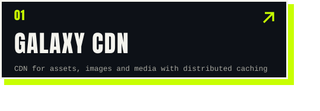</a><a href="https://freegemini.felipeestrela.com.br">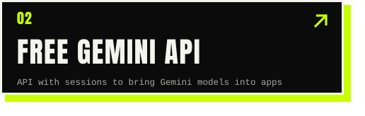</a>
<a href="https://alldrive.cloud">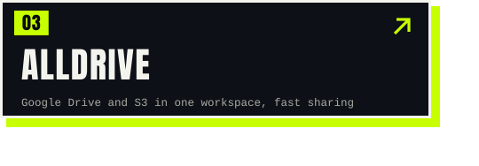</a><a href="https://frameclear.felipeestrela.com.br">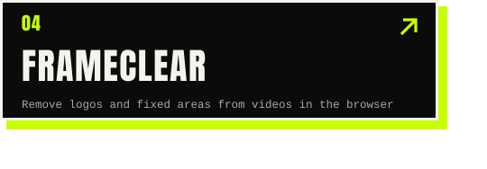</a>
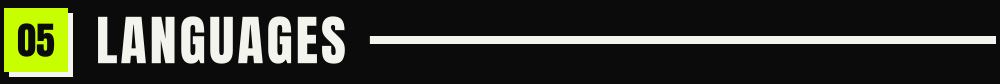
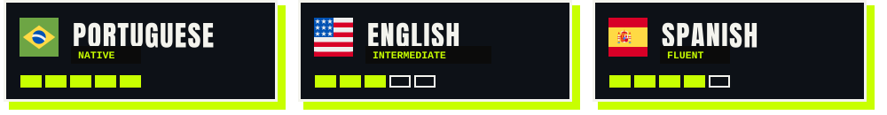

<a href="https://www.linkedin.com/in/felipe-gte">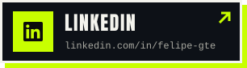</a>

