

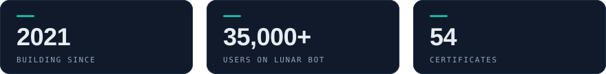

 

&nbsp;&nbsp;

 

I build and operate web systems, APIs and desktop applications, with a focus on **Node.js and TypeScript**, **databases** and **AI automation**: agents, MCP and LLM integrations.

My work covers internal process automation, marketplaces and digital products running in production, including a Discord platform that grew to **35,000+ users**. Based in Toledo, Paraná, Brazil.

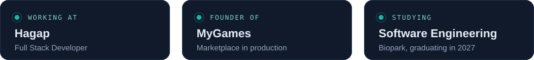

 

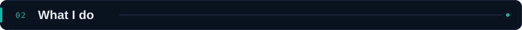

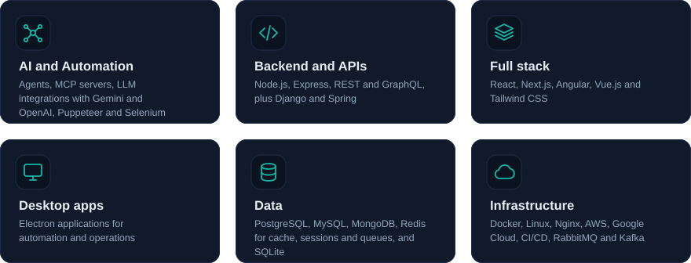

 

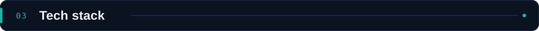

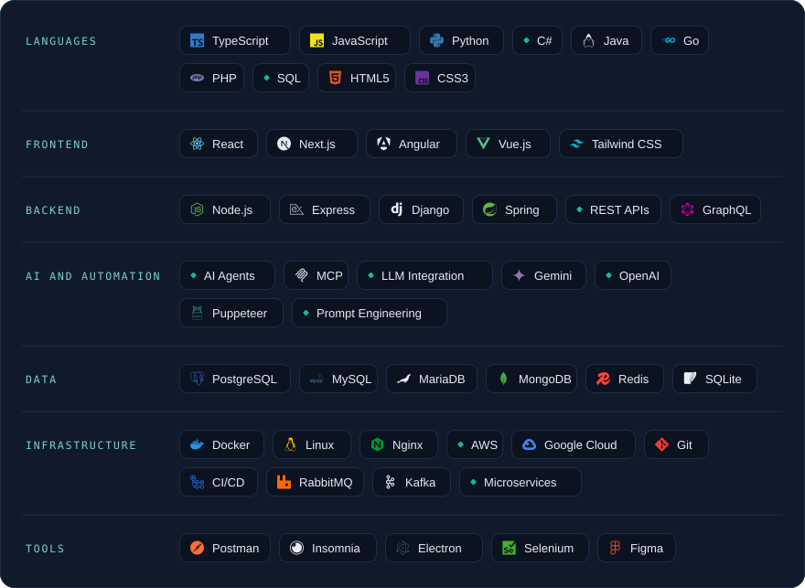

 

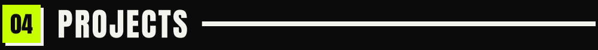

<a href="https://mygames.com.br">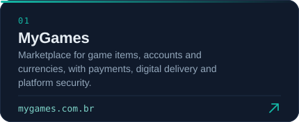</a> <a href="https://galaxycdn.com.br">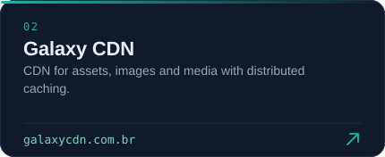</a> 
<a href="https://freegemini.felipeestrela.com.br">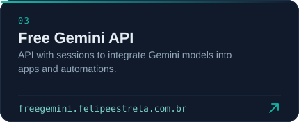</a> <a href="https://alldrive.cloud">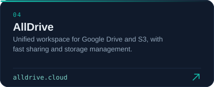</a> 
<a href="https://astrohub.neonstore.cloud">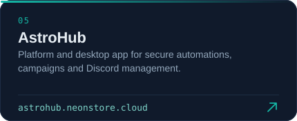</a> <a href="https://frameclear.felipeestrela.com.br">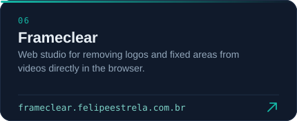</a> 

 

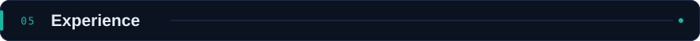

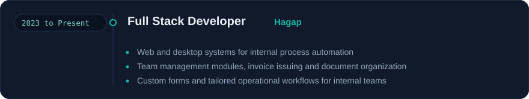

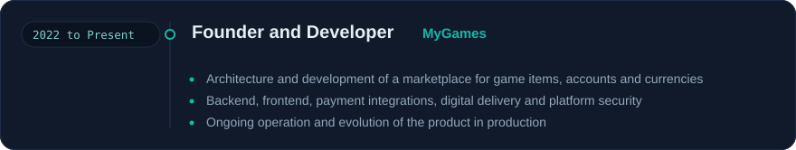

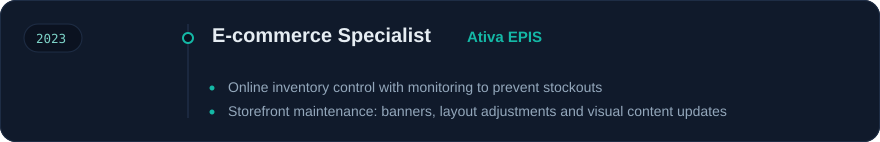

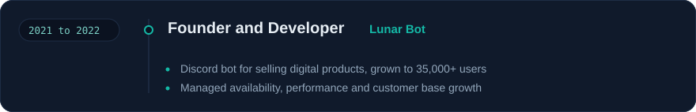

 

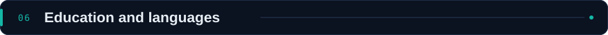

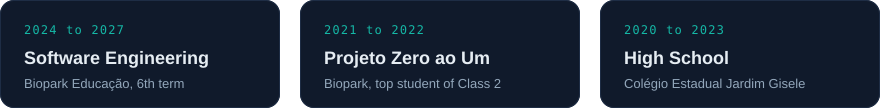

 

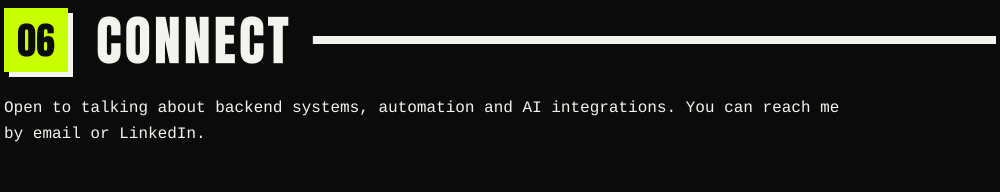

Open to talking about backend systems, automation and AI integrations.

  

&nbsp;&nbsp;

